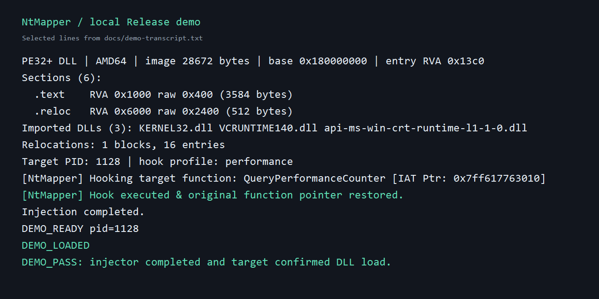
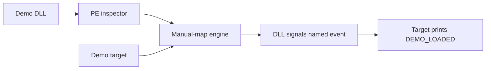

# NtMapper — Windows PE and manual-mapping lab

NtMapper is a C++17/x64 project for exploring the Windows PE format and a user-mode manual-mapping pipeline. It includes a command-line PE inspector and a self-contained target process plus DLL so the result can be reproduced without a third-party application.



## What it demonstrates

- PE32+ parsing with bounds checks for headers, sections, import DLLs, and relocation blocks.
- A manual-mapping pipeline that copies an image, applies relocations, resolves imports, invokes its entry point through the existing IAT trigger, restores the original IAT pointer, clears headers and `.reloc`, and applies section protections.
- A local demo where the target prints `DEMO_LOADED` after the demonstration DLL signals it. The script checks both that marker and the injector's exit status.



## Build and run

Requirements: Windows x64, CMake 3.20+, Visual Studio with the MSVC C++ toolchain and Windows SDK. The existing Visual Studio solution can build the injector; CMake also builds the demo and tests.

```powershell
cmake -S . -B build -A x64
cmake --build build --config Release --parallel
ctest --test-dir build -C Release --output-on-failure
powershell -NoProfile -ExecutionPolicy Bypass -File .\scripts\demo.ps1 -SkipBuild
```

Run the entire sequence, including configuration and tests, from the directory containing your clone:

```powershell
cd NtMapper-Windows-DLL-Injector
powershell -NoProfile -ExecutionPolicy Bypass -File .\scripts\demo.ps1
```

From another directory, pass the absolute path to your clone's script instead:

```powershell
powershell -NoProfile -ExecutionPolicy Bypass -File "<clone-path>\scripts\demo.ps1"
```

The script starts `NtMapperDemoTarget.exe`, inspects `NtMapperDemoPayload.dll`, injects it, and verifies the target's `DEMO_LOADED` line. A real local run is recorded in [the demo transcript](docs/demo-transcript.txt).

## CLI

```text
NtMapper inspect <dll-path>
NtMapper inject <process.exe> <dll-path> [--profile QueryPerformanceCounter|TranslateMessage]
NtMapper <process.exe> <dll-path> [1|2]   # legacy form
NtMapper                                   # interactive mode
```

Starting the Visual Studio project with F5 and no command-line arguments asks for the process name, opens the Windows file picker to select a DLL, then asks which IAT function to try first. **Option 1 (`QueryPerformanceCounter`) is the default**; option 2 tries `TranslateMessage` first. Both options retain the same fallback candidates. `inspect` requires an x64 DLL. `inject` runs the same inspection before attempting the mapping. Exit codes are 0 for success, 2 for invalid or cancelled input, 3 for file or PE errors, 4 for native API or target lookup errors, and 5 for mapping failure.

## Current limits

This is a Windows x64 experiment, not a general replacement for the Windows loader. The demo is verified with the included target and DLL on Windows 11 with MSVC 19.51. The mapper resolves imported function addresses in its own process and uses them in the target; that assumption is not guaranteed for arbitrary processes. It does not explicitly handle every PE loader feature, such as TLS callbacks or delay-loaded imports. A restored IAT pointer confirms that the trigger ran, while the demo's named event separately confirms that the sample DLL's entry point ran.

The PE inspector validates the file structures it reads. It is not a complete PE verifier. The existing header and relocation clearing behavior is retained as part of the experiment; no claim of undetectability is made.

## Interview talking points

- Why RVA-to-file-offset conversion differs from the in-memory image layout.
- Which work the Windows loader normally performs and which parts this experiment implements.
- Why the target's independent `DEMO_LOADED` signal is stronger evidence than the injector's success message alone.
